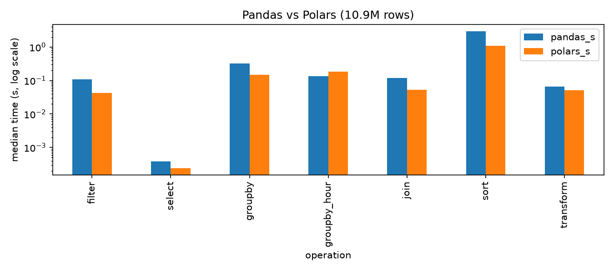
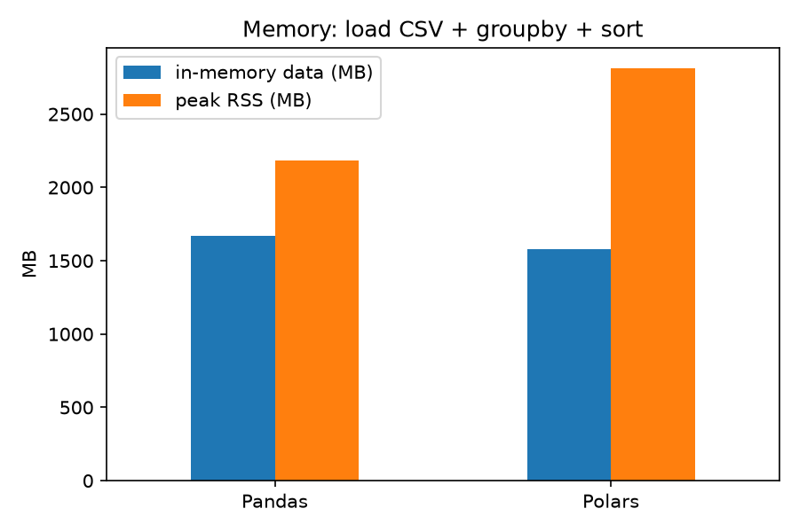
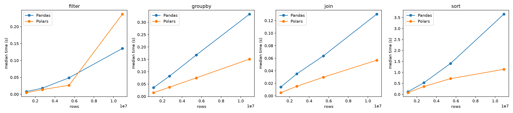

# Polars vs Pandas: Performance Benchmarking

### A Comparative Study of Execution Time, Memory Efficiency, Scalability, and Usability

**Author:** Surya Koundinya C  
**Batch:** G41-AIML  
**Language:** Python  
**Libraries:** Pandas, Polars, NumPy, Matplotlib, PyArrow, psutil

---

## 📌 Project Overview

This project compares two popular Python DataFrame libraries, **Pandas** and **Polars**, using a real-world dataset containing approximately **10.9 million rows**.

The objective is to evaluate their performance in terms of:

- Execution time
- Memory consumption
- Scalability with increasing dataset size
- Data processing efficiency
- API usability

Both libraries perform identical operations on the same dataset to ensure a fair comparison.

The experiments use the eager execution APIs of both libraries.

## 📂 Dataset

**Dataset:** NYC Yellow Taxi Trip Records — January 2016

**Source:** New York City Taxi & Limousine Commission (TLC), obtained as a CSV file from Kaggle.

| Property | Details |
|---|---|
| Dataset file | `yellow_tripdata_2016-01.csv` |
| Dataset size | 1.71 GB |
| Total rows | 10,906,858 |
| Total columns | 19 |
| Format | CSV |
| Domain | Transportation / Taxi Trip Records |

The dataset includes pickup and dropoff timestamps, trip distances, passenger counts, payment types, fares, tips, and total amounts.

## 🎯 Objectives

1. Compare the execution speed of Pandas and Polars.
2. Evaluate memory usage during data processing.
3. Analyze performance as dataset size increases.
4. Compare the usability of both DataFrame APIs.
5. Identify suitable use cases for each library.

## ⚙️ Technologies Used

- **Python** — Programming language
- **Pandas** — Data manipulation and analysis
- **Polars** — High-performance DataFrame processing
- **NumPy** — Numerical operations
- **Matplotlib** — Data visualization
- **PyArrow** — Columnar data support
- **psutil** — System resource monitoring
- **VS Code** — Development environment

## 🔬 Operations Benchmarked

The following operations were implemented in both libraries:

| Operation | Description |
|---|---|
| CSV Loading | Load the dataset and parse datetime columns |
| Filtering | Filter trips by distance and fare |
| Column Selection | Select specific DataFrame columns |
| GroupBy | Aggregate fares, tips, distances, and trip counts |
| Hourly GroupBy | Aggregate data by pickup hour |
| Join | Merge with a payment-type lookup table |
| Sorting | Sort trips by total amount |
| Transformation | Calculate trip duration and tip percentage |

## 📊 Performance Benchmark Results

Execution times were measured using `time.perf_counter()`.

Each operation was executed seven times, and the median execution time was recorded. CSV loading was measured separately using three runs.

### Execution Time Comparison

| Operation | Pandas (s) | Polars (s) | Polars Speedup |
|---|---:|---:|---:|
| Filter | 0.1099 | 0.0432 | 2.55x |
| Select | 0.0004 | 0.0002 | 1.61x |
| GroupBy | 0.3189 | 0.1482 | 2.15x |
| Hourly GroupBy | 0.1341 | 0.1826 | 0.73x |
| Join | 0.1202 | 0.0534 | 2.25x |
| Sort | 2.9444 | 1.1002 | 2.68x |
| Transform | 0.0655 | 0.0515 | 1.27x |

### Key Findings

- Polars performed faster in filtering, grouping, joining, sorting, and transformation.
- Sorting showed the largest performance advantage, with Polars approximately **2.68x faster**.
- Pandas performed better for hourly grouping.
- Column selection was nearly instantaneous in both libraries.
- Polars loaded the CSV approximately **1.22x faster**.

The performance advantage varied by operation and benchmark run.

## 🧠 Memory Usage Analysis

Memory consumption was evaluated by loading the dataset, performing a groupby operation, and sorting the data.

| Memory Metric | Pandas | Polars |
|---|---:|---:|
| In-memory DataFrame size | 1,669 MB | 1,581 MB |
| Peak process memory (RSS) | 2,186 MB | 2,811 MB |

### Observations

- Polars used approximately 5% less memory for the loaded DataFrame.
- Polars showed approximately 29% higher peak process memory.
- Faster execution did not necessarily result in lower peak memory consumption.
- Memory measurements were conducted once per library, so the results are indicative rather than definitive.

## 📈 Scalability Analysis

Scalability was evaluated using four dataset sizes:

| Dataset Percentage | Approximate Rows |
|---|---:|
| 10% | 1.09 million |
| 25% | 2.73 million |
| 50% | 5.45 million |
| 100% | 10.91 million |

### Findings

Both libraries demonstrated approximately linear scaling for filtering, grouping, joining, and transformation.

Polars maintained a consistent advantage for most operations.

For sorting, Polars' performance advantage increased from approximately **1.5x to 3.0x** as the dataset grew.

## 📉 Visualizations

The project includes visual comparisons of:

- Execution time for individual DataFrame operations
- Memory consumption
- Scalability across different dataset sizes
- Polars speedup relative to Pandas

### Benchmark Comparison



### Memory Comparison



### Scalability Comparison



## 🚀 Installation and Setup

### 1. Clone the Repository

```bash
git clone https://github.com/YOUR_USERNAME/YOUR_REPOSITORY.git
cd YOUR_REPOSITORY
```

Replace the placeholders with your GitHub repository details.

### 2. Create a Virtual Environment

```bash
python3 -m venv .venv
```

### 3. Activate the Environment

For macOS/Linux:

```bash
source .venv/bin/activate
```

For Windows:

```bash
.venv\Scripts\activate
```

### 4. Install Dependencies

```bash
pip install -r requirements.txt
```

### 5. Prepare the Dataset

Download the January 2016 NYC Yellow Taxi Trip Records dataset and place the CSV file inside the `data/` directory.

Ensure the dataset path in the Python scripts matches the downloaded file location.

### 6. Run the Benchmarks

The project includes scripts for benchmarking, memory measurement, scalability testing, and plotting.

For example:

```bash
python bench_one.py pandas
python bench_one.py polars
```

Other scripts can be run according to their configured inputs and dataset paths.

## 🔍 Pandas vs Polars

| Feature | Pandas | Polars |
|---|---|---|
| Core implementation | Python / C / Cython | Rust |
| Execution model | Eager | Eager and Lazy |
| Parallel processing | Mostly single-threaded | Multi-threaded |
| API | Index-based DataFrame API | Expression-based API |
| Ecosystem | Very mature | Growing |
| Large-data performance | Good | Often faster |
| Memory efficiency | Workload-dependent | Workload-dependent |

## 🏆 Conclusion

The experiment demonstrates that **Polars generally outperformed Pandas in execution speed** when processing the 10.9-million-row taxi dataset.

Polars achieved approximately 1.3x–3x speedups for several data-processing operations, particularly sorting, joining, and aggregation.

However, Pandas performed better for hourly grouping and had lower peak memory usage in this experiment.

**Polars is a strong choice for large-scale data processing and computationally intensive workloads, while Pandas remains an excellent choice for smaller datasets, exploratory analysis, and compatibility with the wider Python ecosystem.**

These findings apply to the dataset, hardware, and eager execution APIs evaluated in this study.

## ⚠️ Limitations

- Benchmarks were performed on one MacBook Pro.
- Only one real-world dataset was evaluated.
- Only eager execution was tested.
- Memory measurements were performed once per library.
- The effect of Polars' `rechunk()` operation was evaluated, but its execution cost was not included in benchmark timings.
- Performance may vary with hardware, data formats, and workloads.

## 📚 References

- [Pandas Documentation](https://pandas.pydata.org/docs/)
- [Polars Documentation](https://docs.pola.rs/)
- [NYC TLC Trip Record Data](https://www.nyc.gov/site/tlc/about/tlc-trip-record-data.page)
- [Matplotlib Documentation](https://matplotlib.org/stable/)

---

**Project:** Polars vs Pandas — Performance, Memory Efficiency, Scalability, and Usability

**Author:** Surya Koundinya C